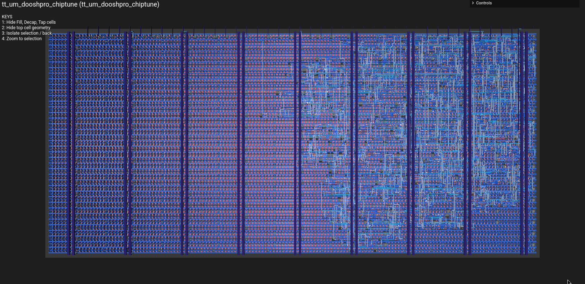

   

# Chiptone Piano
This is a 8-bit chiptune piano built using Verilog. It has 8 input pins, each representing a musical note from C4 to C5. Each key uses one independent counter to generate a square wave at the required frequency. The design uses a 100 kHz clock to generate the notes. It also includes a vibrato effect that slightly changes the pitch over time. The combined audio signal is sent through output pin uo_out[7].



## Project Setup
For project setup, install OSS CAD Suite environment. After setup, the waveforms can be viewed with GTKWave by running the commands: 
```py
cd test
make -B
gtkwave tb.fst tb.gtkw
```